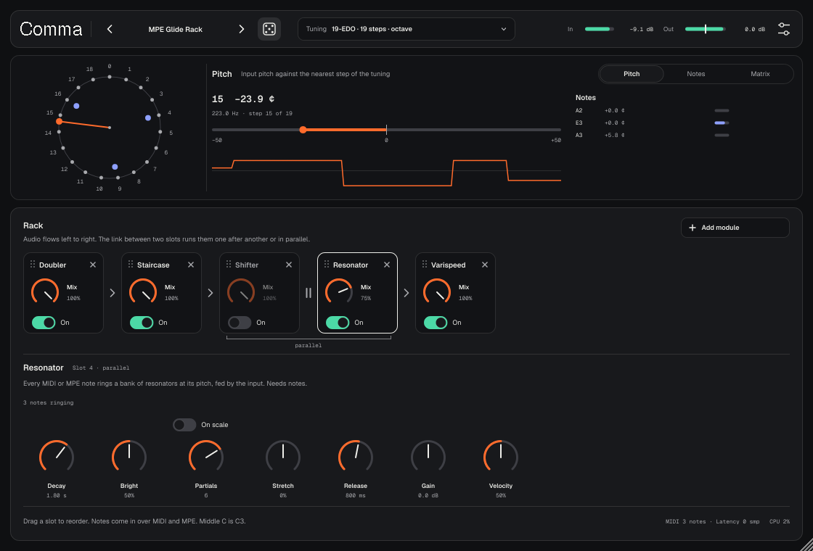
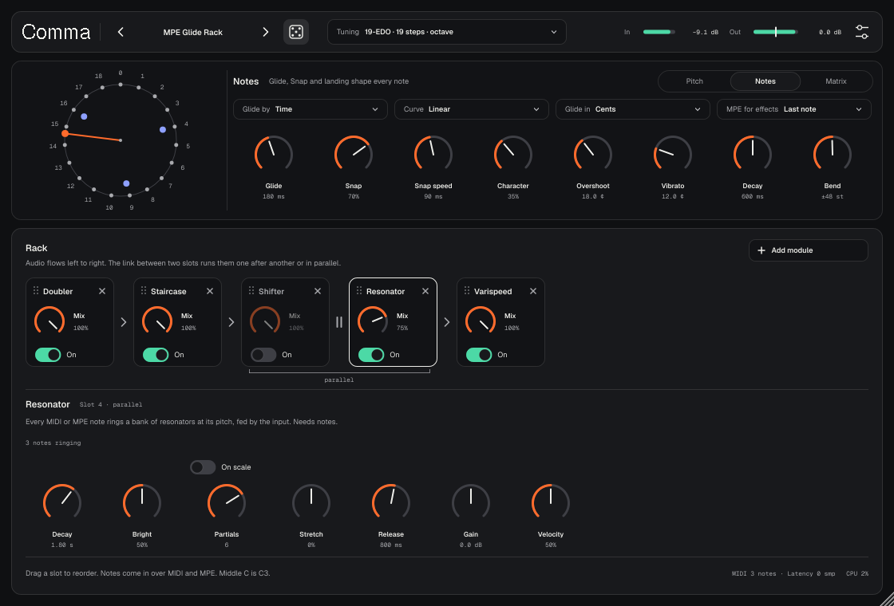
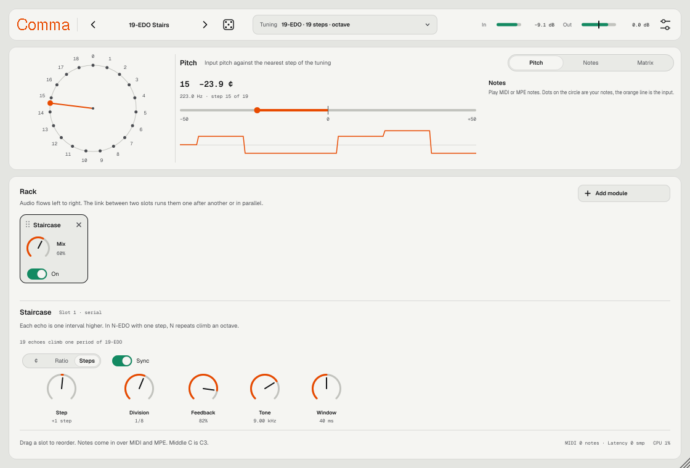
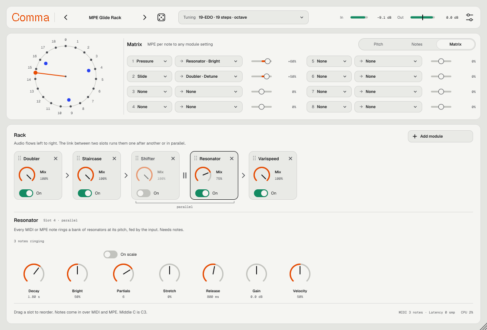

<p align="center">
  
</p>

<p align="center">
  
  
  
  
</p>

<p align="center">
  <a href="https://github.com/controloptioncommand/commavst/releases/latest/download/Comma-macOS.zip"><b>⬇ Скачать Comma для macOS</b></a>
</p>

---

**Comma** — вайбкод-эффект: rack для экспериментов с высотой тона. Микротональность (EDO, чистый строй, строи Scala) и MPE-глайды: дублер на пару центов, эхо, которое поднимается по ступеням строя, резонаторы, настроенные нотами, частотный сдвиг в темп песни, спектр, перенесённый на ступени строя. Ориентир по звуку — микротональная электроника вроде Aloboi.

Брат [Mist](https://github.com/controloptioncommand/Mist-vst), [Eido](https://github.com/controloptioncommand/Eido-vst), [Sumi](https://github.com/controloptioncommand/Sumi-vst), [chrōma](https://github.com/controloptioncommand/chroma-vst) и [Granula](https://github.com/controloptioncommand/Granula-vst): те же темы Oxygen и Rubber, шрифты Medeo и страница About.

## Строй — один на весь rack

- **12-EDO**, любое **N-EDO** (1–96), свои **отношения** (`1/1 9/8 5/4 4/3 3/2 5/3 15/8 2/1`, `3/2 7/4 11/8 2/1`, период может быть и не октавой — `3/1`), файлы **Scala** `.scl` + `.kbm` (хранятся в проекте) или строй от мастера **MTS-ESP**. Корень и A4 — в меню строя.
- Comma может и сам быть **мастером MTS-ESP**: раздать свой строй синтезаторам в проекте.
- Интервал в каждом модуле — в одной из трёх единиц: **центы**, **отношение** или **шаги строя**.
- **Круг строя** показывает ступени, высоту входа и ноты; вкладка **Pitch** — отклонение входа от ближайшей ступени в центах и его историю.

## Ноты и MPE

Comma — эффект с нотным входом (AU типа Music Effect, VST3, CLAP): аудио на входе, ноты MIDI / MPE рядом. Полный MPE: сообщение MCM, member channels, бенд на каждую ноту (±48 по умолчанию), pressure, slide (CC74), strike и lift.

- **Glide** — время или скорость в центах в секунду, три кривые, линейно в центах или в герцах.
- **Snap** — магнит: пока высота движется, она свободна; остановилась — притягивается к ближайшей ступени строя.
- **Character** — от непрерывного портаменто к глиссандо по ступеням.
- **Посадка** — небольшой перелёт и затухающее вибрато при остановке на ступени.
- **Мод-матрица** — 8 строк: любое измерение MPE на любую ручку любого модуля; Resonator модулируется отдельно на каждую ноту.

<p align="center">
  
</p>

## Модули

| Модуль | Что делает | Как устроен |
|---|---|---|
| **Doubler** | Копии на ±N центов или ±1 шаг строя, левая выше, правая ниже; задержка 0–30 мс; Focus — ВЧ-фильтр на обработанном | Линия задержки, две головки со сдвигом на пол-окна, окно Ханна |
| **Harmonizer** | Два голоса на отношениях, центах или шагах строя | Quality — PSOLA по высоте соло-голоса; Low latency — линия задержки |
| **Staircase** | Каждое эхо на шаг строя выше: в N-EDO за N повторов — октава; обратная связь, синхронизация с темпом | Питч-шифтер в петле обратной связи задержки |
| **Autotune** | Подтягивает соло-голос к ступеням строя или к нотам, которые вы держите; скорость задаёт глайд | YIN + PSOLA (или линия задержки в Low latency) |
| **Resonator** | Каждая нота включает банк резонаторов на своей высоте с бендом, Glide и Snap; на вход — любой звук; партиалы можно настроить по ступеням строя | Двухполюсные резонаторы, до 16 голосов × 8 партиалов |
| **Shifter** | Сдвиг в герцах, barber-pole на обратной связи, биения в темп: Δf = BPM / 60 / доли | Фильтр Гильберта (две цепочки allpass), однополосная модуляция |
| **Varispeed** | Высота ленты в центах, рампы по темпу, wow и flutter, тормоз ленты | Чтение ленты с переменной скоростью (интерполяция Эрмита), высота — шифтер на линии задержки |
| **Spectral** | Snap — партиалы на ступени строя; Stretch — гармоники растягиваются под период строя (идея Сетареса) | STFT, поиск пиков, фазовый вокодер с привязкой фаз |

<p align="center">
  
</p>

## Rack

- До 8 слотов, каждый модуль — не больше одного раза (параметры не меняют ID, автоматизация не ломается). **Add module**, крестик — убрать, перетаскивание — порядок (или Alt + ← / →).
- У каждого слота **Mix** и **On** (bypass). **Связка** между слотами: последовательно или параллельно.
- Модули с анализом — два режима: **Low latency** и **Quality**. Comma сообщает хосту общую задержку: последовательные слоты складываются, параллельные выравниваются. Bypass задержку не меняет.
- **Undo / Redo** — ⌘Z / ⇧⌘Z или меню настроек.

<p align="center">
  
</p>

## 🎲 Кубик, пресеты, темы

- Кубик — случайные Mix и ручки модулей в rack'е в безопасных пределах; строй, ноты, матрицу, состав rack'а, bypass и громкость не трогает. Что можно — настройки → Randomizer.
- 20 шаблонов: Micro Double, 19-EDO Stairs, Octave in Seven, Barber Pole, Tempo Beats, Just Choir, Hard Tune, Glide Tune 31, Ringing Strings, Scale Bells, MPE Glide Rack, Tape Stop, Sethares Snap, Bohlen-Pierce Stretch и другие. Свои пресеты несут rack и строй: `~/Music/Comma/Presets/*.comma`.
- **Oxygen** — светлая, **Rubber** — тёмная, или по системе.

## Установка

1. Скачайте **[Comma-macOS.zip](https://github.com/controloptioncommand/commavst/releases/latest/download/Comma-macOS.zip)** и распакуйте.
2. В Терминале:
   ```bash
   bash ~/Downloads/Comma-macOS/install-mac.sh
   ```
   Скрипт кладёт `Comma.vst3`, `Comma.component` и `Comma.clap` в `~/Library/Audio/Plug-Ins` и снимает карантин macOS: плагин подписан ad-hoc, без сертификата Apple.
3. Перезапустите DAW. В Logic Comma — в меню **MIDI-controlled Effects**, ноты — через меню Side Chain в окне плагина. В Ableton — на аудиодорожке, ноты — MIDI To с MIDI-дорожки.

Подробное руководство — **[Comma-manual.pdf](docs/Comma-manual.pdf)**, оно же лежит в архиве релиза.

Нужен Mac с macOS 11 или новее (Apple Silicon или Intel). Каждое изменение в `main` автоматически собирается, проходит pluginval и auval и выкладывается в [Releases](https://github.com/controloptioncommand/commavst/releases).

## Сборка

```bash
cmake -B build -DCOMMA_BUILD_TESTS=ON && cmake --build build --config Release --target Comma_VST3 Comma_AU Comma_CLAP CommaTest
./build/CommaTest_artefacts/Release/CommaTest ./render
```

JUCE 8, clap-juce-extensions, tuning-library и MTS-ESP скачиваются автоматически. Нужен компилятор с C++20.

Тест проверяет разбор `.scl` / `.kbm`, EDO и отношения, переводы центы ↔ отношения ↔ шаги, питч-шифтеры по БПФ (сдвиг синуса на ±10 центов), каждый модуль (дублер, лестницу эхо, частотный сдвиг и подавление зеркальной частоты, гармонайзер, автотюн к строю и к нотам, резонатор на ноте и бенде, varispeed, спектр), нотный слой MPE (MCM, бенд, Glide, Snap, характер, посадка), мод-матрицу, математику rack'а и задержки, состояние и пресеты, 40 бросков кубика, частоты 44.1–96 кГц и блоки от 1 до 4096, и снимает скриншоты.

Руководство в PDF собирается из `docs/manual/Comma-manual.html` (нужны Python 3 с Pillow и Node.js с Playwright):

```bash
bash docs/manual/build.sh
```

## Устройство

| Где | Что |
|---|---|
| `Source/Tuning/` | Строй: снимок для аудиопотока, EDO, отношения, Scala (tuning-library), единицы интервала, MTS-ESP |
| `Source/Notes/` | Нотный слой: MPE, голоса, Glide, Snap, характер, посадка |
| `Source/DSP/` | Задержка с Hermite, питч-шифтер на линии задержки, Гильберт, YIN, PSOLA |
| `Source/Rack/` | Rack (mix, bypass, параллель, задержка) и восемь модулей |
| `Source/PluginProcessor.*` | Строй и rack в состоянии, мод-матрица, undo, выход с защитой |
| `Source/UI/` | Темы Oxygen / Rubber, круг строя, вкладки Pitch / Notes / Matrix, слоты, панели модулей, About |

Написан на C++ и [JUCE 8](https://juce.com). Чужой код и данные — в [THIRD_PARTY.md](THIRD_PARTY.md).

<p align="center"><sub>made by nnn · vibe-coded with Claude</sub></p>
