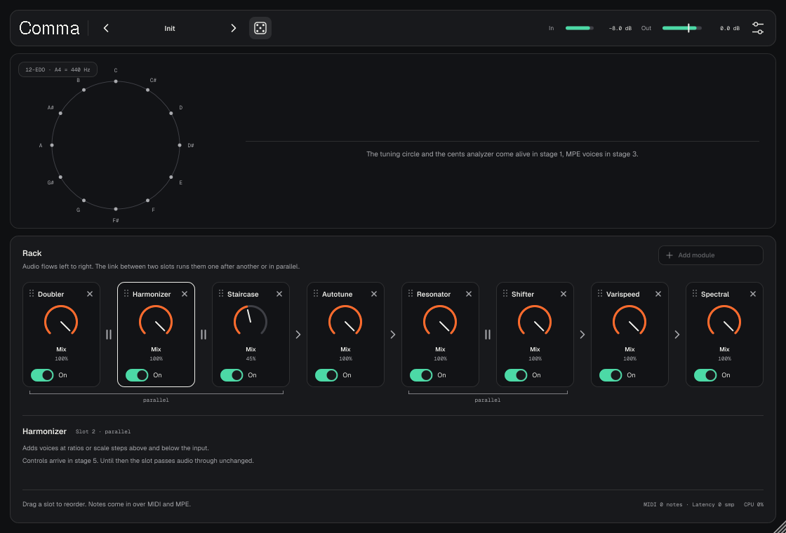
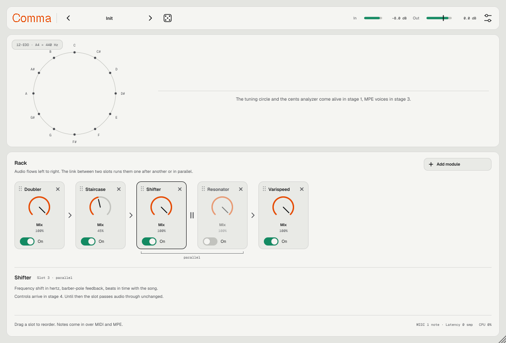

<p align="center">
  
</p>

<p align="center">
  
  
  
  
</p>

---

**Comma** — вайбкод-эффект: rack для экспериментов с высотой тона. Микротональность (EDO, just intonation, строи Scala) и MPE-глайды: дублер на пару центов, эхо, которое поднимается по ступеням строя, резонаторы, настроенные нотами, частотный сдвиг в темп песни. Ориентир по звуку — микротональная электроника вроде Aloboi.

Брат [Mist](https://github.com/controloptioncommand/Mist-vst), [Eido](https://github.com/controloptioncommand/Eido-vst), [Sumi](https://github.com/controloptioncommand/Sumi-vst), [chrōma](https://github.com/controloptioncommand/chroma-vst) и [Granula](https://github.com/controloptioncommand/Granula-vst): те же темы Oxygen и Rubber, шрифты Medeo и страница About.

> **Версия 0.1 — каркас.** Rack, слоты, Mix, bypass и параллельные цепочки уже работают, но модули пока пропускают звук без изменений. Модули появляются по этапам, ниже — план.

## Эффект с нотным входом

Comma стоит на аудиодорожке как обычный эффект, но принимает ноты MIDI и MPE: микротональность и глайды задаются нотами, потому что чистый аудиоэффект не перестроит аккорд в другой строй. Модулям, которым ноты не нужны, MIDI не нужен вовсе.

- **Logic**: Comma — Audio Unit типа Music Effect, ищите его в меню MIDI-controlled Effects, ноты — с любой MIDI-дорожки.
- **Ableton Live**: VST3 или AU на аудиодорожке, ноты — с MIDI-дорожки (MIDI To → дорожка с Comma).
- **Bitwig, Reaper**: CLAP или VST3.

## Rack

- До 8 слотов, каждый модуль — не больше одного раза. Добавить — **Add module**, убрать — крестик на карточке.
- У каждого слота **Mix** и **On** (выключенный слот — bypass).
- Порядок — перетащите карточку (или Alt + ← / →).
- **Связка** между слотами: шеврон — следующий слот обрабатывает выход предыдущего; «‖» — оба слушают один вход, их выходы смешиваются. Параллельные слоты выравниваются по задержке, плагин сообщает хосту общую задержку.
- **Undo / Redo** — ⌘Z / ⇧⌘Z или меню настроек.

<p align="center">
  
</p>

## Модули

| Модуль | Что делает | Этап |
|---|---|---|
| **Doubler** | Копии на ±N центов или ±1 шаг строя, левая и правая в разные стороны; задержка 0–30 мс; фильтр высоких частот на обработанном сигнале | 2 |
| **Staircase** | Каждое эхо сдвинуто на шаг строя: в N-EDO за N повторов набирается октава; обратная связь, синхронизация с темпом | 2 |
| **Resonator** | Каждая MPE-нота включает банк резонаторов на своей высоте (с бендом, Glide и Snap); на вход — любое аудио; партиалы можно настроить по ступеням строя | 3 |
| **Shifter** | Частотный сдвиг в герцах, обратная связь (barber-pole), биения в темп: Δf = BPM / 60 × деление | 4 |
| **Harmonizer** | Голоса на интервалах-отношениях или в шагах строя | 5 |
| **Autotune** | Подтягивает монофонический голос к ступеням строя; скорость подтяжки задаёт характер глайда | 5 |
| **Varispeed** | Замедление и разгон ленты, wow и flutter, рампы высоты в центах по темпу | 6 |
| **Spectral** | Переносит партиалы на ступени строя, чтобы тембр звучал консонансно в этом строе (идея Сетареса) | 7 |

Общее для всех модулей (этап 1): строй — Scala .scl + .kbm, N-EDO или отношения (3/2, 7/4, 11/8), получение строя по MTS-ESP; интервал задаётся в центах, отношением или шагами строя. Нотный слой (этап 3): полный MPE, Glide, Snap к ступеням, характер скольжения от портаменто до глиссандо, мод-матрица на каждый голос.

## 🎲 Кубик

Кнопка-кубик в тулбаре: случайный Mix модулей (не ниже 40 %). Громкость выхода, состав rack'а и bypass не трогает. Порядок слотов и параллельные группы — только если разрешить: настройки → Randomizer. С каждым звучащим модулем у кубика будет появляться своя группа.

## Пресеты

Шаблон **Init** — пустой rack; шаблоны со звуком появятся вместе с модулями. Свои пресеты — меню пресета → Save preset, вместе с составом rack'а, лежат в `~/Music/Comma/Presets/*.comma`. Пресет не трогает громкость выхода.

## Две темы

**Oxygen** — светлая, **Rubber** — тёмная, или по системе: иконка настроек → Appearance. Там же размер окна.

## Установка

1. Скачайте архив `Comma-macOS.zip`: со страницы [Releases](https://github.com/controloptioncommand/commavst/releases) или, пока релиза нет, из Artifacts последней [сборки](https://github.com/controloptioncommand/commavst/actions). Распакуйте.
2. В Терминале:
   ```bash
   bash ~/Downloads/Comma-macOS/install-mac.sh
   ```
   Скрипт кладёт `Comma.vst3`, `Comma.component` и `Comma.clap` в `~/Library/Audio/Plug-Ins` и снимает карантин macOS: плагин подписан ad-hoc, без сертификата Apple.
3. Перезапустите DAW или пересканируйте плагины.

Нужен Mac с macOS 11 или новее (Apple Silicon или Intel). Каждое изменение в `main` автоматически собирается, проходит pluginval и auval и выкладывается в Releases.

## Сборка

```bash
cmake -B build -DCOMMA_BUILD_TESTS=ON && cmake --build build --config Release --target Comma_VST3 Comma_AU Comma_CLAP CommaTest
./build/CommaTest_artefacts/Release/CommaTest ./render
```

JUCE 8 и clap-juce-extensions скачиваются автоматически.

Тест проверяет математику rack'а на тестовых модулях (Mix, bypass, параллельные группы, выравнивание задержки, смену состава без щелчка), проход звука без изменений, защиту выхода, MIDI и MPE-каналы, сохранение состава rack'а в проекте и пресетах, undo, 40 бросков кубика, частоты 44.1–96 кГц и блоки от 1 до 4096 семплов, скорость, и снимает скриншоты.

## Устройство

| Где | Что |
|---|---|
| `Source/Rack/` | Интерфейс модуля, фабрика модулей, Rack: Mix, bypass, параллель, выравнивание задержки |
| `Source/PluginProcessor.*` | Состав rack'а в состоянии, undo, выход с защитой |
| `Source/Presets.*`, `Source/Randomizer.*` | Шаблоны и кубик |
| `Source/UI/` | Интерфейс, темы Oxygen / Rubber, круг строя, слоты rack'а, About |

Написан на C++ и [JUCE 8](https://juce.com). Чужой код и данные — в [THIRD_PARTY.md](THIRD_PARTY.md).

<p align="center"><sub>made by nnn · vibe-coded with Claude</sub></p>
